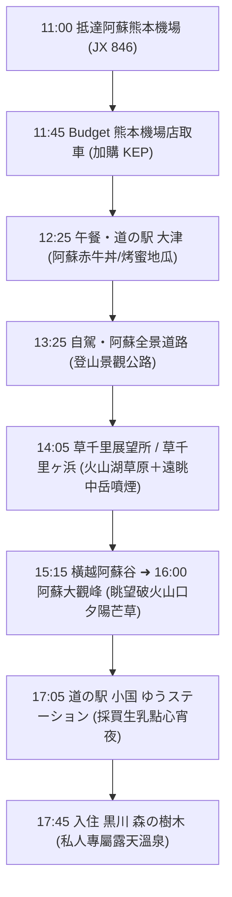

# 11/15(日) 阿蘇

> **今日路線**：阿蘇熊本機場 ➜ 道之驛大津 ➜ 阿蘇全景道路 ➜ **草千里展望所（草千里ヶ浜）＋ 阿蘇中岳火山口** ➜ 阿蘇大觀峰 ➜ 黑川森之樹木木屋  
> **今日總車程**：約 78 km｜**純行車時間**：約 1 小時 55 分  
> **行程導航**：[返回總行程目錄](file:///c:/Users/WW/Documents/repo/2026熊本/kyushu-autumn-travel-guide.md) ｜ [前往 11/16(一) 由布院 ➡️](file:///c:/Users/WW/Documents/repo/2026熊本/1116(一)_由布院.md)

---

## 🕒 今日行程流程圖

---

## 📍 景點與自駕導航詳細資訊

### 【第一階段：落地取車與午餐】（11:00 - 13:25）

#### 1. 11:00 - 12:15 入境與 Budget 取車
- **班機**：星宇航空 JX 846（台北桃園 07:45 ➜ 阿蘇熊本 11:00）。
- **流程**：
  1. 出關提領行李後，前往國內線航廈的 **Budget 租車櫃台**。
  2. 搭乘門口免費接駁車前往「Budget 熊本空港店」（車程約 3 分鐘）。
  3. **櫃台辦理手續**：
     - 出示護照、台灣駕照正本、駕照日文譯本正本。
     - 確認已保 **Safety Pack 全險**（CDW + NOC + 道路救援零負擔）。
     - **現場加購 KEP 高速公路周遊券**（Day 3、Day 4 上高速公路省很大）。
     - 取車時與店員繞車一圈，用手機錄影/拍照記錄既有小刮痕。
- **Budget 熊本空港店資訊**：
  - 地址：熊本県菊池郡菊陽町戸次1563
  - 電話：`096-232-8543`
  - [Google Maps 定位](https://maps.app.goo.gl/9QZJ2qH9fFwGqR6f7)

---

#### 2. 12:25 - 13:25 午餐：道の駅 大津（Ozu）
- **自駕資訊**：距離租車店約 7 km，開車約 10 分鐘。
  - 電話：`096-293-7887`
  - MapCode：`161 302 443*55`
  - [Google Maps 定位](https://maps.app.goo.gl/8e2b8oE5G6V9XzR3A)
- **停車**：附設大型免費停車場。
- **午餐推薦**：
  - **老公推薦**：餐廳「よかよ」點招牌**阿蘇赤牛丼**（半熟蛋搭配香嫩多汁的赤牛肉片）或鐵板漢堡排定食。
  - **太太推薦**：若飛機餐剛吃飽不太餓，可至戶外物產區購買大津特產**現烤蜜地瓜**（蜜芋）、地瓜鯛魚燒或赤牛熱騰騰可樂餅。兩人坐在休息區一起享用，輕鬆無壓力。

---

### 【第二階段：阿蘇全景公路與草千里火山奇景】（13:25 - 15:15）

#### 3. 13:25 - 14:05 景觀公路：阿蘇全景道路（阿蘇パノラマライン）
- **自駕資訊**：大津出發，走國道 57 號轉縣道 298 號、111 號上山，約 25 km，開車約 35～40 分鐘。
- **沿途景致**：
  - 全線路況寬敞良好，從平地一路爬升至海拔 1,100 公尺的阿蘇火山核心區。
  - 沿途會途經可愛的火山錐「米塚（Komezuka）」，山形宛如倒扣的大碗，秋天呈現焦糖金黃色，非常吸睛。

---

#### 4. 14:05 - 15:15 草千里展望所 ＋ 草千里ヶ浜（壯闊火山草原）
- **自駕交通與停車資訊**：
  - 導航電話：`0967-34-2111`（阿蘇火山博物館）
  - 車載導航 MapCode：`256 456 795*03`
  - 停車場：**草千里有料駐車場**（車位約 500 台，小客車單次 500 日圓）。
  - [Google Maps 定位](https://maps.app.goo.gl/wY3u7j8j4LwT9y7k9)
- **看點與漫步體驗**：
  - **雙圓形火山湖草原**：草千里是一座直徑達 1 公里的古老火山口遺跡，廣袤的草原中央有兩座天然雨水水塘，倒映著藍天與後方雄偉的「烏帽子岳」。
  - **遠眺中岳活火山白煙**：站在展望台木棧道上，可以直接看到遠方阿蘇中岳第一火山口不斷噴出壯麗的白煙，氣勢磅礡！
  - **火山博物館與咖啡小憩**：可在草千里景觀咖啡廳買一杯香濃的阿蘇澤西鮮奶拿鐵或冰淇淋，坐在窗邊欣賞這片宛如異星世界的蒼茫大地。
  - *(備註：若當日火山氣體安全等級開放，亦可順道開往中岳火山口停車場近距離觀賞火山口；若受氣體管制，在草千里展望所遠眺即最為壯觀安全)*。

---

### 【第三階段：橫越阿蘇谷與大觀峰夕陽】（15:15 - 16:45）

#### 5. 15:15 - 16:00 自駕前往阿蘇大觀峰
- **自駕交通**：草千里出發 ➜ 沿縣道 111 號下山穿過阿蘇市區平原 ➜ 沿國道 212 號攀上北側外輪山脊，約 28 km，開車約 40～45 分鐘。
- **路況體驗**：一路從火山中央盆地穿越阿蘇田園村落，再蜿蜒開上外輪山最高點，視野層次變化豐富極具自駕樂趣。

---

#### 6. 16:00 - 16:45 阿蘇大觀峰（夕陽絕景）
- **自駕資訊**：
  - 電話：`0967-32-3856`
  - MapCode：`256 878 300*66`
  - 停車費：**免費停車場**（車位約 130 台）。
  - [Google Maps 定位](https://maps.app.goo.gl/9K1n9q7D5m3g8vKTA)
- **遊覽攻略**：
  - 停好車後沿著平緩步道步行約 3～5 分鐘即可抵達展望台。
  - 站在海拔 936 公尺的外輪山最高點，回頭俯瞰剛剛造訪的阿蘇五岳火山群（宛如沉睡的臥佛）與整座壯麗的阿蘇破火山口平原。
  - **11 月中旬日落約在 17:15**，此時斜陽將整座阿蘇山谷與山坡上的芒草染成一片耀眼金黃，是拍照留念的最佳時刻。
  - *貼心提醒*：山頂風大、傍晚氣溫降至 8～12 度，下車記得加件保暖外套與圍巾。

---

### 【第四階段：物產館採買與入住木屋】（16:45 - 晚上）

#### 7. 17:05 - 17:30 道の駅 小国 ゆうステーション
- **自駕資訊**：大觀峰出發約 16 km，開車約 20 分鐘。
  - 營業時間：物產館通常至 17:30～18:00。
  - [Google Maps 定位](https://maps.app.goo.gl/T4a1gL5pD8t9m8rD7)
- **特色採買**：
  - 建築本身為特殊的倒金字塔木造玻璃建築。
  - **必吃美食**：「OGUNIYA JERSEY」小國澤西牛純生乳霜淇淋（極度濃郁香醇）。
  - **採買點心**：小國澤西生乳、手工布丁、在地阿蘇精釀啤酒，買回木屋當夜晚泡湯後的頂級宵夜。

---

#### 8. 17:45 Check-in：黒川 森の樹木（獨立溫泉小木屋）
- **自駕資訊**：小國休息站出發約 8 km，開車約 12 分鐘。
  - 地址：熊本県阿蘇郡南小国町満願寺5634-1
  - 電話：`0967-44-0688`
  - [Google Maps 定位](https://maps.app.goo.gl/PijNXt3EDmJ7Agfv6)
- **木屋亮點**：
  - 坐落於靜謐森林中的獨立木屋，車子可直接停在木屋專屬車位，搬行李極度輕鬆。
  - **專屬私人露天風呂**：每棟木屋均自帶天然炭酸水素塩泉露天風呂，完全不需去大眾池，100% 隱私與安全感。
  - 晚上可在森林蟲鳴與滿天星空下享受溫暖的溫泉，徹底洗去飛行與開車的疲累。

---

## 💡 今日自駕小叮嚀
1. **右駕適應**：前 30 分鐘請記住「左轉小彎、右轉大彎」，隨時提醒自己「駕駛座靠中線」。
2. **高山保暖**：草千里海拔約 1,100 公尺，風勢通常較大，下車散步請穿防風防寒外套。
3. **天黑路況**：阿蘇山區路燈較少，今日安排在 17:45 天黑前抵達木屋，行車非常安全無壓力。
