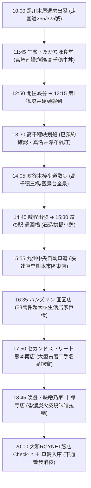

# 11/17(二) 高千穗

> **今日路線**：黑川退房 ➜ たかちほ食堂 ➜ 高千穗峽划船賞楓（13:30 已預約）➜ 通潤橋 ➜ **ハンズマン 画図店 ➜ セカンドストリート 熊本南店 ➜ 晚餐：味噌乃家 十禅寺店 ➜ 大和ROYNET飯店**  
> **今日總車程**：約 156 km｜**純行車時間**：約 2 小時 50 分  
> **行程導航**：[⬅️ 回到 11/16(一) 由布院](file:///c:/Users/WW/Documents/repo/2026熊本/1116(一)_由布院.md) ｜ [返回總行程目錄](file:///c:/Users/WW/Documents/repo/2026熊本/kyushu-autumn-travel-guide.md) ｜ [前往 11/18(三) 佐賀 ➡️](file:///c:/Users/WW/Documents/repo/2026熊本/1118(三)_佐賀.md)

---

## 🕒 今日行程流程圖

---

## 📍 景點與自駕導航詳細資訊

### 【第一階段：早晨退房與高原景觀公路自駕】（10:00 - 11:45）

#### 1. 10:00 退房出發：行駛國道 265 號與國道 325 號
- **早晨節奏**：在木屋吃完早餐、收拾行李，10:00 辦理退房發車。
- **自駕行車路線**（黑川 ➜ 高千穗，約 73 km，開車約 1 小時 35 分～1 小時 45 分）：
  - 從黑川往南，途經阿蘇外輪山東側的「箱石峠」與高森町。
  - 全線為雙向柏油平整道路，秋天沿途經過雄偉的阿蘇外輪山、高原牧場與森林，山嵐繚繞極具自駕樂趣。

---

### 【第二階段：高千穗峽午餐與夢幻划船體驗】（11:45 - 14:45）

#### 2. 11:45 - 12:45 【午餐】たかちほ食堂（高千穗超人氣在地食堂）
- **自駕資訊**：
  - 地址：宮崎県西臼杵郡高千穂町三田井1099-1
  - 電話：`0982-72-2173`
  - 營業時間：11:00–14:00
  - [開啟 たかちほ食堂 Google Maps 定位](https://maps.app.goo.gl/nN6L6eS5h5YV3y2k8)
  - **停車位**：店門口附設約 6 台免費車位；若停滿可停對面高千穗町綜合運動公園停車場。
- **高 CP 值美食推薦（每人約 1,000～1,500 日圓，現金支付）**：
  - **招牌必點・宮崎南蠻炸雞定食（チキン南蛮定食，約 1,200 日圓）**：宮崎在地靈魂美食！大塊多汁的現炸雞肉，外皮金黃酥脆，裹上特調酸甜南蠻甘醋，再淋上滿滿濃郁塔塔醬，酸甜解膩極為下飯。
  - **高千穗牛丼 / 石鍋拌飯（約 1,000～1,100 日圓）**：以親民價格品嚐頂級高千穗牛，肉質甜嫩香濃。
  - **時間節奏**：出餐效率極高（點餐後約 10～15 分鐘上菜），12:45 即可輕鬆享用完畢，前往碼頭時間綽綽有餘。

---

#### 3. 12:50 - 13:15 開車前往高千穗峽谷底碼頭
- **交通**：從餐廳開車約 7 分鐘（3.5 km），沿專用下坡車道直達峽谷底。
- **最佳停車選擇**：
  - **導航目標**：**高千穂峡 第1御塩井（おしおい）駐車場**
  - **費用**：一次 1,000 日圓。
  - **優勢**：停在第 1 停車場走下樓梯 1 分鐘直接抵達划船碼頭！免去停在上方第 2、第 3 停車場需要爬 30 層樓陡峭樓梯的體力消耗。

---

#### 4. 13:15 - 14:05 【已確認預約】高千穗峽划船（13:30 梯次）
- **報到重要須知**：
  - **請於 13:15 前抵達乘船處售票櫃台報到**。
  - 出示預約完成確認信／預約番號，由工作人員引導穿著救生衣。
- **划船體驗重點（13:30 - 14:00，30 分鐘）**：
  - 夫妻同乘一艘木舟（由老公掌槳，划法很簡單，順著水流操控即可）。
  - 近距離划至日本百選名瀑「真名井瀑布」正下方，感受水氣撲面的壯闊震撼。
  - 抬頭仰望高達 80～100 公尺的阿蘇火山玄武岩柱狀節理絕壁，岩壁上點綴著火紅與金黃楓葉，宛如身處神話仙境。
  - 拍照建議：在瀑布兩側以山壁楓紅為背景互相拍照，效果絕佳！

---

#### 5. 14:05 - 14:40 峽谷木棧步道漫步
- **步道攻略（平緩無難度）**：
  - 划完船後，沿著峽谷步道漫步至「真名井瀑布展望台」，從高處往下俯瞰瀑布墜入碧綠峽谷與划船木舟的經典九州明信片全景。
  - 沿途可欣賞「鬼八之力石（重達 200 噸的巨大神話巨石）」以及「高千穗三橋（橫跨峽谷的三座不同時代拱橋）」。

---

### 【第三階段：經通潤橋開往熊本購物第一站】（14:45 - 16:35）

#### 6. 15:30 - 15:55 道の駅 通潤橋（Tsujunkyo）
- **自駕交通**：14:45 高千穗出發，行駛國道 218 號約 40 km，開車約 45 分鐘。
  - [Google Maps 定位](https://maps.app.goo.gl/uX3L3c5XgV4a5P8z6)
- **看點**：
  - 參觀列為日本國寶的石造水路拱橋「通潤橋」，建築雄偉壯觀。
  - 休息站建築極為新穎舒適，設有咖啡廳與在地農特產展售區，可在此喝杯咖啡小憩、換手或上洗手間。

#### 7. 15:55 - 16:35 九州中央自動車道 ➜ 熊本市區東南
- **行車路線**：
  - 從「山都通潤橋 IC」上高速公路，經「嘉島 JCT」下交流道，行車約 33 km，約 40 分鐘直達生活旗艦商場聚集的熊本市東區重富一帶。
  - 全程可使用 KEP 高速公路周遊券。

---

### 【第四階段：生活巨蛋血拼 ＋ 二手名品挖寶】（16:35 - 18:40）

#### 8. 16:35 - 17:35 ハンズマン 画図店（HANDSMAN 九州超大生活居家巨蛋）
- **自駕交通與停車資訊**：
  - 地址：熊本県熊本市東区画図町大字重富1014-8
  - 電話：`096-379-6611`
  - 營業時間：**07:00 – 22:00**
  - 停車場：**附設超大型免費停車場**（數百個車位，停車超方便）。
  - [Google Maps 定位](https://maps.app.goo.gl/4fLwX7t4K3a9nB5A8)
- **商場亮點**：
  - 九州最具代表性的全方位 DIY 與居家生活旗艦店，單店商品數超過 **28 萬件**！
  - 涵蓋高品質日系廚房餐具、家居收納、特色文具手作、園藝綠植、戶外露營用品與生活日用品，品項齊全到令人嘆為觀止，極具探索與採買樂趣。

---

#### 9. 17:50 - 18:40 セカンドストリート 熊本南店（2nd STREET 大型二手潮流挖寶）
- **自駕交通與停車資訊**（距離 Handsman 約 4.5 km，開車約 12～15 分鐘）：
  - 地址：熊本県熊本市南区江越1丁目20-33
  - 電話：`096-328-5801`
  - 營業時間：**10:00 – 20:00**
  - 停車場：**附設專屬免費停車位**。
  - [Google Maps 定位](https://maps.app.goo.gl/u5K8X3vJ9rY4aC6B9)
- **商場亮點**：
  - 日本最知名大型綜合二手連鎖店的熊本南區旗艦門市。
  - 店內陳列極為乾淨明亮，嚴選各大品牌男女服飾、潮流球鞋、日系精品包款、復古手錶、戶外裝備與小型生活家電，性價比極高，常常能挖到近乎全新的夢幻逸品！

---

### 【第五階段：香濃拉麵晚餐 ➜ 飯店入住】（18:45 - 晚上）

#### 10. 18:45 - 19:45 【晚餐】味噌乃家 十禅寺店（超人氣炭火炙燒味噌拉麵）
- **自駕交通與停車資訊**（從 2nd STREET 開車僅 **700 公尺，2 分鐘直達**！）：
  - 地址：熊本県熊本市南区平田1-1-11
  - 電話：`096-324-8788`
  - 營業時間：**11:00 – 22:00**（週二正常營業無休）
  - 停車場：**店門口附設專用免費停車場**（吃飽再走，完全不用另找車位）。
  - [Google Maps 定位](https://maps.app.goo.gl/8nL8W3kX6zP4bA7E9)
- **必吃美食推薦**：
  - **招牌・特製炙燒味噌拉麵（炙り特製味噌ラーメン）**：以大火在高溫鐵鍋中爆炒新鮮豆芽與洋蔥，散發極為誘人的鍋氣，再注入以九州特選熟成味噌慢火熬煮的濃郁高湯，湯頭醇厚回甘。
  - **特厚炙燒叉燒**：整片厚切叉燒經炭火炙烤，外微焦香脆、內部入口即化。
  - **辛味噌拉麵 / 香脆日式煎餃**：喜歡微辣口感推薦點辛味噌，搭配現煎酥脆冰花餃子，在深秋夜裡吃上一碗熱騰騰拉麵超級暖心滿足！

---

#### 11. 20:00 Check-in：大和ROYNET飯店 熊本銀座通店 PREMIER
- **自駕交通**：從餐廳沿國道 3 號直通市中心，約 2.8 km，開車僅約 8～10 分鐘。
  - 地址：熊本県熊本市中央区新市街1-1
  - 電話：`096-311-6055`
  - [開啟飯店 Google Maps 定位](https://maps.app.goo.gl/ymrPLoDX8nSj3oVu9)
- **停車與入住便利性**：
  - 直接將車輛駛入飯店一樓**機械式立體停車塔**（每晚約 1,800～2,000 日圓，先到先停）。
  - 將剛才在 Handsman 與 2nd STREET 採買的所有戰利品輕鬆搬入房間。
- **晚上放鬆散步**：
  - 飯店下樓就是熱鬧的「下通商店街」，吃飽後可牽手散步消化，若還想逛街，下通的唐吉訶德、松本清、Bic Camera 都營業到深夜！

---

## 💡 今日自駕小叮嚀
1. **划船準時性**：高千穗划船已確認預約 13:30 梯次，請務必於 **13:15 前** 在碼頭櫃台出示預約番號報到。
2. **購物停車免費**：今日安排的「ハンズマン 画図店」、「セカンドストリート 熊本南店」與「味噌乃家 十禅寺店」皆附設**專屬免費停車場**，免去市區找車位與繳停車費的煩惱。
3. **戰利品收納**：吃完晚餐再回飯店 Check-in，可以直接把所有採買物品一次推上樓回房，動線最流暢省力！
