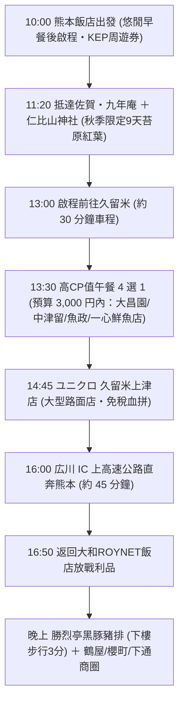

# 11/18(三) 佐賀

> **今日路線**：熊本出發 ➜ 佐賀九年庵 ＋ 仁比山神社 ➜ 久留米午餐（和牛燒肉 / 極鮮生魚片 4 選 1）➜ UNIQLO 久留米上津店（免稅血拼）➜ 返回熊本市區（下樓吃勝烈亭黑豚豬排）  
> **今日總車程**：約 170 km｜**純行車時間**：約 2 小時 30 分（全日高速公路，全程使用 KEP 周遊券定額吃到飽）  
> **行程導航**：[⬅️ 回到 11/17(二) 高千穗](file:///c:/Users/WW/Documents/repo/2026熊本/1117(二)_高千穗.md) ｜ [返回總行程目錄](file:///c:/Users/WW/Documents/repo/2026熊本/kyushu-autumn-travel-guide.md) ｜ [前往 11/19(四) 熊本 ➡️](file:///c:/Users/WW/Documents/repo/2026熊本/1119(四)_熊本.md)

---

## 🕒 今日行程流程圖

---

## 📍 景點與自駕導航詳細資訊

### 【第一階段：早晨悠閒出發 ➜ 秋季限定 9 天・佐賀九年庵】（10:00 - 13:00）

#### 1. 10:00 飯店出發：九州自動車道（使用 KEP）
- **早晨節奏**：睡到自然醒，可於飯店 2 樓加購享用「菅乃屋」招牌馬肉咖哩與和洋早餐，10:00 準時發車。
- **自駕路線**：熊本 IC / 植木 IC ➜ 九州自動車道北上 ➜ 鳥栖 JCT ➜ 長崎自動車道「東脊振 IC」（約 85 km，開車約 1 小時 15 分）。
- **高速公路周遊券（KEP）**：此段往返原過路費約 5,000 日圓，取車時購買的 KEP 可直接全額涵蓋，省時又省錢。

---

#### 2. 11:20 - 13:00 佐賀 九年庵 ＋ 仁比山神社 ＋ 參道市集
- **自駕交通與停車**：
  - 導航搜尋：`九年庵` 或 `吉野ヶ里歴史公園 臨時駐車場`（公開期間有專用接駁車直達門口）。
  - 地址：佐賀県神埼市神埼町的1688
  - 電話：`0952-37-0107`
  - [Google Maps 定位](https://maps.app.goo.gl/o1bZ1X4jQ8R5vV7C9)
- **看點一：九年庵（每年僅開放約 9 天的國之名勝）**：
  - 佐賀實業家伊丹彌太郎花費 9 年歲月建造的日式數寄屋別墅與苔庭，**每年僅在 11 月中下旬深秋紅葉見頃時開放約 9 天**！
  - 鋪滿厚實翠綠的青苔地毯，當金紅楓葉飄落於綠苔之上，紅白綠相映成趣，是九州極致庭園美學。
- **看點二：仁比山神社（就在九年庵隔壁，步行 1 分鐘）**：
  - 被茂密巨大楓樹包圍的古老神社，有千年神木（巨大楠木）與古色古香的仁王門，清幽莊嚴。
- **看點三：參道屋台小吃**：
  - 參道兩側有佐賀在地特色小吃攤位，可品嚐現烤醬油糰子、烤地瓜、甘酒，感受秋祭熱鬧氛圍。

---

### 【第二階段：高 CP 值午餐 4 選 1（預算 3,000 円以內）】（13:30 - 14:40）

從九年庵開車約 30 分鐘抵達久留米市區，夫妻倆可根據當天心情，選擇**頂級黑毛和牛燒肉**或**極鮮厚切生魚片**（4 家店皆附設免費停車場，且午間套餐每人皆在 3,000 日圓預算內）：

#### 🥩 燒肉選擇（2 選 1）：
1. **【焼肉の大昌園 上津店】（環境最氣派奢華，就在 UNIQLO 旁 3 分鐘！）**
   - 價位：午間和牛定食約 **1,800 ～ 2,500 日圓**（含特選黑毛和牛、白飯、湯品、沙拉、小菜）。
   - 特色：久留米 50 年老牌奢華燒肉王者！日式庭園造景、獨立隔間包廂與無煙烤爐，花 2,000 多日圓就能享受高級日式料亭氛圍，肉質油脂香甜。
   - 地址：福岡県久留米市藤光町258-1（距離 UNIQLO 僅 1.5 km，開車 3 分鐘，附大停車場）
   - 電話：`0942-21-0321`｜週三正常營業
2. **【焼肉・鉄板焼 中津留（Nakatsuru）】（老字號精肉店直營，肉質第一）**
   - 價位：和牛燒肉定食約 **1,650 ～ 2,400 日圓**；人氣爆紅「和牛極上赤身牛排丼」約 **1,800 ～ 2,200 日圓**。
   - 特色：昭和 45 年創立的肉品老舖直營！自家專屬牧場挑選黑毛和牛，肉質多汁軟嫩，CP 值天花板。
   - 地址：福岡県久留米市通町400-7（2F，附專用免費停車場）
   - 電話：`0942-34-1338`

#### 🍣 壽司與生魚片選擇（2 選 1）：
3. **【魚政（うおまさ / Uomasa）】（鮮魚行直營，海鮮滿載）**
   - 價位：名物海宝丼定食約 **1,800 ～ 2,400 日圓**；厚切刺身御膳約 **1,650 ～ 2,200 日圓**。
   - 特色：鮮魚批發行轉型的高人氣海鮮名店！海寶丼鋪滿海膽、鮭魚卵、極上鮪魚中腹與當季白身魚；生魚片御膳厚切鮮美。
   - 地址：福岡県久留米市津福本町1719-6（距離 UNIQLO 僅 3.5 km，開車 8 分鐘，附專屬停車場）
   - 電話：`0942-38-4688`｜週三正常營業
4. **【一心鮮魚店】（在地神級排隊名店，只要 1,430 円的超澎湃壽司定食）**
   - 價位：招牌「すし定食（壽司定食）」驚人特惠價只要 **1,430 日圓（含稅）**！
   - 特色：鮮魚店直營！含 **8 貫大片厚切握壽司（海膽、鮭魚卵、鮪魚等）** ＋ **手掌大現炸酥脆開邊大草蝦** ＋ 茶碗蒸 ＋ 味噌湯，份量誠意十足！
   - 地址：福岡県久留米市梅満町562（附專用免費停車場）
   - 電話：`0942-32-6019`

---

### 【第三階段：UNIQLO 免稅血拼 ➜ 輕鬆回熊本】（14:45 - 晚上）

#### 3. 14:45 - 15:55 ユニクロ 久留米上津店（大型路面店・免稅 TAX FREE）
- **自駕交通**：吃飽後開車約 3～8 分鐘直達門市。
  - 地址：福岡県久留米市本山2丁目3番31号
  - 營業時間：10:00 – 20:00
  - 停車：**附設超大型專用免費停車場**。
  - [Google Maps 定位](https://maps.app.goo.gl/9x3U6k5y7b8A2z1A9)
- **購物優勢**：
  - **支援免稅（TAX FREE）**：消費滿 5,000 日圓即可出示護照正本直接享有免稅優惠。
  - 路面獨立大店，秋冬羽絨衣、保暖發熱衣、喀什米爾毛衣與最新聯名款式尺碼極度齊全，買完直接整袋放後車廂超輕鬆！

---

#### 4. 16:00 - 16:50 經「広川 IC」快速返回熊本市區
- **交通**：
  - 從 UNIQLO 往南開僅 **3.5 km（約 7 分鐘）** 即可直上九州自動車道 **「広川 IC」**！
  - 一路順暢南下開回熊本市區（約 65 km，開車只要約 45～50 分鐘，全程 KEP 定額免過路費）。
- **下午回到市區優勢**：在 17:00 前回到飯店停好車，完全避開下班塞車潮，司機毫無長途駕駛負擔！

---

#### 5. 17:30 晚餐：勝烈亭 新市街總店 ＋ 下通商圈血拼
- **晚餐首選（下樓步行 3 分鐘）**：
  - **勝烈亭 新市街總店**：品嚐米其林推薦鹿兒島產「六白黑豚」特選炸豬排定食，外酥內嫩多汁。
- **晚上自由活動**：
  - 步行漫遊下通拱頂商店街、新市街（松本清藥妝、驚安殿堂唐吉訶德、Bic Camera），採買藥妝與伴手禮。

---

## 💡 今日自駕小叮嚀
1. **車程輕鬆減半**：刪除深山環境藝術之森後，今日來回大幅節省 100 多公里，行車極為愜意。
2. **免稅護照**：在 UNIQLO 結帳時，請務必隨身攜帶護照正本以利辦理免稅。
3. **高速公路通行**：上下「東脊振 IC」與「広川 IC」時請行駛 ETC 專用道，全程享有 KEP 定額吃到飽優惠。
