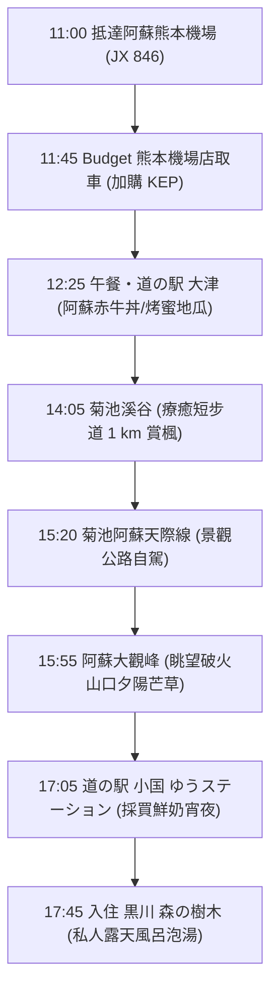

# 🍁 Day 1（11/15 日）：入境取車 ➜ 菊池溪谷 ➜ 阿蘇大觀峰 ➜ 黑川木屋

> **今日主題**：落地九州、自駕初體驗、菊池溪谷翡翠綠紅葉步道、阿蘇外輪山絕景夕陽、入住宿坊獨享露天風呂。  
> **今日總車程**：約 70 km｜**純行車時間**：約 1 小時 45 分  
> **導覽導航**：[返回總行程目錄](file:///c:/Users/WW/Documents/repo/2026熊本/kyushu-autumn-travel-guide.md) ｜ [前往 Day 2 ➡️](file:///c:/Users/WW/Documents/repo/2026熊本/day2.md)

---

## 🕒 今日行程流程圖

---

## 📍 景點與自駕導航詳細資訊

### 【第一階段：落地取車與午餐】（11:00 - 13:25）

#### 1. 11:00 - 12:15 入境與 Budget 取車
- **班機**：星宇航空 JX 846（台北桃園 07:45 ➜ 阿蘇熊本 11:00）。
- **流程**：
  1. 出關提領行李後，前往國內線航廈的 **Budget 租車櫃台**。
  2. 搭乘門口免費接駁車前往「Budget 熊本空港店」（車程約 3 分鐘）。
  3. **櫃台辦理手續**：
     - 出示護照、台灣駕照正本、駕照日文譯本正本。
     - 確認已保 **Safety Pack 全險**（CDW + NOC + 道路救援零負擔）。
     - **現場加購 KEP 高速公路周遊券**（Day 3、Day 4 上高速公路省很大）。
     - 取車時與店員繞車一圈，用手機錄影/拍照記錄既有小刮痕。
- **Budget 熊本空港店資訊**：
  - 地址：熊本県菊池郡菊陽町戸次1563
  - 電話：`096-232-8543`
  - [Google Maps 定位](https://maps.app.goo.gl/9QZJ2qH9fFwGqR6f7)

---

#### 2. 12:25 - 13:25 午餐：道の駅 大津（Ozu）
- **自駕資訊**：距離租車店約 7 km，開車約 10 分鐘。
  - 電話：`096-293-7887`
  - MapCode：`161 302 443*55`
  - [Google Maps 定位](https://maps.app.goo.gl/8e2b8oE5G6V9XzR3A)
- **停車**：附設大型免費停車場。
- **午餐推薦**：
  - **老公推薦**：餐廳「よかよ」點招牌**阿蘇赤牛丼**（半熟蛋搭配香嫩多汁的赤牛肉片）或鐵板漢堡排定食。
  - **太太推薦**：若飛機餐剛吃飽不太餓，可至戶外物產區購買大津特產**現烤蜜地瓜**（蜜芋）、地瓜鯛魚燒或赤牛熱騰騰可樂餅。兩人坐在休息區一起享用，輕鬆無壓力。

---

### 【第二階段：溪谷紅葉與天際線自駕】（13:25 - 16:45）

#### 3. 14:05 - 15:20 菊池溪谷（秋季紅葉名所）
- **自駕資訊**：從道の駅 大津出發約 22 km，開車約 40 分鐘。
  - 導航搜尋：`菊池渓谷 第1駐車場`
  - 電話：`0968-27-0210`
  - MapCode：`256 319 864*33`
  - 停車費：一般車輛 300 日圓；維持維護費（門票）：每人 300 日圓。
  - [Google Maps 定位](https://maps.app.goo.gl/r3hZ3wU9qK5p8e7Z6)
- **步道攻略（療癒精華短步道 癒しコース）**：
  - **全長約 1 公里**，全程約需 40～50 分鐘，路況為平整木棧道與步道，無連續長階梯，走起來舒適輕鬆。
  - **沿途看點**：翡翠綠清澈溪水貫穿火山岩石，兩側楓樹層層疊疊染上鮮紅與金黃；必拍「黎明之瀑（黎明の滝）」與「紅葉瀨（紅葉の瀬）」，水氣伴隨陽光極具仙氣。

---

#### 4. 15:20 - 15:55 景觀公路：菊池阿蘇天際線（菊池阿蘇スカイライン）
- **自駕資訊**：菊池溪谷 ➜ 阿蘇大觀峰，約 24 km，開車約 35 分鐘。
- **亮點**：
  - 九州屈指可數的高原景觀道路，一路從密林綠意爬升至阿蘇外輪山山脊。
  - 沿線視野豁然開朗，秋天兩旁是整片迎風搖曳的金黃色芒草波浪，開車兜風極為享受。

---

#### 5. 15:55 - 16:45 阿蘇大觀峰（夕陽絕景）
- **自駕資訊**：
  - 電話：`0967-32-3856`
  - MapCode：`256 878 300*66`
  - 停車費：**免費停車場**（車位約 130 台）。
  - [Google Maps 定位](https://maps.app.goo.gl/9K1n9q7D5m3g8vKTA)
- **遊覽攻略**：
  - 停好車後沿著平緩步道步行約 3～5 分鐘即可抵達展望台。
  - 站在海拔 936 公尺的外輪山最高點，俯瞰整座雄偉的「阿蘇破火山口（Caldera）」平原與宛如「臥佛」的阿蘇五岳。
  - **11 月中旬日落約在 17:15**，此時斜陽將整座阿蘇山谷與山坡上的芒草染成一片耀眼金黃，是拍照留念的最佳時刻。
  - *貼心提醒*：山頂風大、傍晚氣溫降至 8～12 度，下車記得加件保暖外套與圍巾。

---

### 【第三階段：物產館採買與入住木屋】（16:45 - 晚上）

#### 6. 17:05 - 17:30 道の駅 小国 ゆうステーション
- **自駕資訊**：大觀峰出發約 16 km，開車約 20 分鐘。
  - 營業時間：物產館通常至 17:30～18:00。
  - [Google Maps 定位](https://maps.app.goo.gl/T4a1gL5pD8t9m8rD7)
- **特色採買**：
  - 建築本身為特殊的倒金字塔木造玻璃建築。
  - **必吃美食**：「OGUNIYA JERSEY」小國澤西牛純生乳霜淇淋（極度濃郁香醇）。
  - **採買點心**：小國澤西生乳、手工布丁、在地阿蘇精釀啤酒，買回木屋當夜晚泡湯後的頂級宵夜。

---

#### 7. 17:45 Check-in：黒川 森の樹木（獨立溫泉小木屋）
- **自駕資訊**：小國休息站出發約 8 km，開車約 12 分鐘。
  - 地址：熊本県阿蘇郡南小国町満願寺5634-1
  - 電話：`0967-44-0688`
  - [Google Maps 定位](https://maps.app.goo.gl/PijNXt3EDmJ7Agfv6)
- **木屋亮點**：
  - 坐落於靜謐森林中的獨立木屋，車子可直接停在木屋專屬車位，搬行李極度輕鬆。
  - **專屬私人露天風呂**：每棟木屋均自帶天然炭酸水素塩泉露天風呂，完全不需去大眾池，100% 隱私與安全感。
  - 晚上可在森林蟲鳴與滿天星空下享受溫暖的溫泉，徹底洗去飛行與開車的疲累。

---

## 💡 今日自駕小叮嚀
1. **右駕適應**：前 30 分鐘請記住「左轉小彎、右轉大彎」，隨時提醒自己「駕駛座靠中線」。
2. **天黑路況**：阿蘇山區路燈較少，今日安排在 17:45 天黑前抵達木屋，行車非常安全無壓力。
3. **保暖準備**：山區海拔較高，入夜氣溫較平地低 5～7 度，外出時請備妥風衣。
