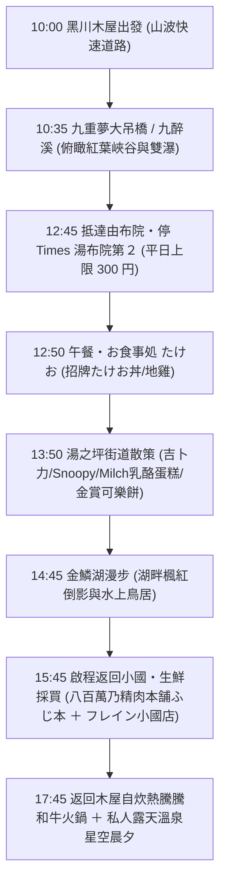

# 🍁 Day 2（11/16 一）：山波公路 ➜ 九重夢大吊橋 ➜ 由布院 ➜ 黑川木屋自炊溫泉

> **今日主題**：早晨睡到自然醒、日本百名道「山波公路」、日本最高九重夢大吊橋俯瞰紅葉峽谷、由布院漫遊（たけお丼＋金鱗湖＋特色小店）、小國採買黑毛和牛與馬刺身、木屋火鍋自炊＋專屬露天溫泉。  
> **今日總車程**：約 98 km｜**純行車時間**：約 2 小時  
> **導覽導航**：[⬅️ 回到 Day 1](file:///c:/Users/WW/Documents/repo/2026熊本/day1.md) ｜ [返回總行程目錄](file:///c:/Users/WW/Documents/repo/2026熊本/kyushu-autumn-travel-guide.md) ｜ [前往 Day 3 ➡️](file:///c:/Users/WW/Documents/repo/2026熊本/day3.md)

---

## 🕒 今日行程流程圖

---

## 📍 景點與自駕導航詳細資訊

### 【第一階段：早晨睡到自然醒＋九重壯闊紅葉】（10:00 - 12:00）

#### 1. 10:00 出發：景觀名道「山波公路（やまなみハイウェイ）」
- **早晨節奏**：不用趕早起床！早上在小木屋沖杯咖啡、在專屬私人露天風呂泡個晨湯，**10:00 準時悠閒出發**。
- **沿途景致**：
  - 行駛於被列為「日本百名道」的山波快速公路（縣道 11 號）。
  - 秋季兩旁滿是翻騰起伏的金黃芒草，遠眺雄偉壯麗的九重連峰，車流順暢、視野極度遼闊。

---

#### 2. 10:35 - 12:00 九重「夢」大吊橋 ＋ 九醉溪
- **自駕交通資訊**（距離黑川約 22 km，開車約 35 分鐘）：
  - **導航設定**：
    - 車載導航 MapCode：`269 012 156`
    - 電話號碼搜尋：`0973-73-3800`
    - [開啟 九重“夢”大吊橋（中村エリア）Google Maps](https://maps.app.goo.gl/3V7Qc7K6q3tGz8aA9)
  - **停車場**：中村側附設 **229 台大型免費停車場**，停車完全免費且極為寬敞方便。
- **門票**：現場自動售票機購票，每人 500 日圓。
- **看點與玩法**：
  - **日本最高人行吊橋**：全長 390 公尺、高達 173 公尺，橫跨鳴子川溪谷。
  - **360 度紅葉全景**：走在橋上宛如漫步雲端，兩側峽谷在 11 月中旬層林盡染，可清楚俯瞰「日本百選名瀑」——雄瀑與雌瀑的「震動之瀑（震動の滝）」。
  - **九醉溪紅葉隧道**：開車離開吊橋時，順路駛入九醉溪沿岸公路，兩側險峻絕壁被楓紅與黃櫨覆蓋，美不勝收。

---

### 【第二階段：由布院午餐、甜點與金鱗湖散策】（12:45 - 15:45）

#### 3. 12:45 停車推薦：タイムズ湯布院駅前第２（Times）
- **自駕交通**：九重夢大吊橋 ➜ 由布院，約 28 km，開車約 40 分鐘。
- **超划算停車策略**：
  - **停車場名稱**：タイムズ湯布院駅前第２（Times Yufuin Ekimae No.2）
  - **地址**：大分県由布市湯布院町川北4-1
  - **車位與費用**：21 台車位；**平日全日最高上限僅 300 日圓**（極度便宜！由布院多數停車場以小時計費動輒 500～1000 日圓）。
  - **地理優勢**：
    - 距離午餐「お食事処 たけお」僅 180 公尺（步行 2 分鐘）。
    - 吃完午餐不用移車，直接順著散步路線走進湯之坪街道逛街，省時又省錢！
  - [Google Maps 定位](https://maps.app.goo.gl/8v35tU5Qp4zP7oA9A)

---

#### 4. 12:50 - 13:50 午餐：お食事処 たけお（在地隱藏版名店）
- **地點**：大分県由布市湯布院町川上2928-4（由布院站步行約 3 分鐘）。
  - 營業時間：11:30–14:30
  - [Google Maps 定位](https://maps.app.goo.gl/7YvJ6hU65fJ2qjA77)
- **必點招牌推薦**：
  - **たけお丼（約 1,300 日圓）**：店內招牌靈魂料理！滿滿豐富在地時令有機蔬菜，搭配特調醬汁與生牛肉／地雞肉末，附上一顆生蛋黃與少許現磨芥末，拌勻後一口咬下層次豐富、清爽美味。
  - **地雞燒定食 / 豐後牛料理**：肉質 Q 彈有勁、炭香濃郁，熱騰騰下飯極佳。

---

#### 5. 13:50 - 14:45 湯之坪街道特色逛街與必吃點心
- 從餐廳散步約 5 分鐘即可銜接至人氣滿滿的「湯之坪街道」：
  - **どんぐり共和国（吉卜力橡子共和國 由布院店）**：充滿龍貓與宮崎駿動畫週邊，門口龍貓拍照必打卡。
  - **Snoopy 茶屋（史努比茶屋）**：日式和風風格的史努比商品與限定甜點。
  - **Yufuin Floral Village（由布院花卉村）**：宛如英國科茲窩小鎮的童話歐風造景，有可愛的水豚、貓咪和各種繪本手作小舖。
  - **排隊散步甜點**：
    - **Milch（由布院ミルヒ）**：招牌「半熟乳酪蛋糕（ケーゼクーヘン）」，可選擇熱騰騰現烤（流心爆漿）或冰涼綿密兩種口感。
    - **金賞可樂餅（金賞コロッケ）**：外皮炸得酥脆，咬下去牛肉內餡香氣四溢、多汁爆漿。

---

#### 6. 14:45 - 15:45 金鱗湖漫步賞楓
- **亮點**：
  - 走到街道底端即抵達金鱗湖。湖底因同時有冷泉與溫泉湧出，水溫適中，秋季午後陽光灑在湖面，波光粼粼宛如金色魚鱗。
  - 沿著環湖步道漫步，欣賞金黃紅葉倒映在水面的湖光山色，並可參拜建於湖中的「天祖神社水上鳥居」，拍照極富意境。

---

### 【第三階段：生鮮肉品採買與木屋火鍋自炊】（15:45 - 晚上）

#### 7. 15:45 - 17:15 啟程返回小國町・晚餐生鮮採買
- **自駕資訊**：由布院出發開回小國町，約 48 km，開車約 55 分鐘。
- **貼心準備**：請隨車攜帶保冷袋與保冷劑（或在店內索取免費冰塊）。

##### 🥩 肉品專賣推薦（頂級阿蘇赤牛與馬肉刺身）：
1. **八百萬乃精肉本舗 ふじ本**（大推！在地人強烈推薦的優質肉舖）：
   - 地址：熊本県阿蘇郡小国町宮原1584
   - 特色：專門提供高品質的**熊本黑毛和牛、阿蘇赤牛火鍋肉片**（油花細緻香醇），以及當日現切的新鮮**生馬肉刺身（馬刺し）**，附特調甜醬油與薑泥蒜泥，完全無腥味，入口鮮甜甘甜！
   - [Google Maps 定位](https://maps.app.goo.gl/9QZJ2qH9fFwGqR6f7)
2. **岩永本店**（備選老舖）：在地老牌精肉店，和牛切片與馬刺身品質極佳。

##### 🥬 超市生鮮採買（蔬菜、火鍋料與飲品）：
- **フレイン 小国店（Super Flein Oguni）**：
  - 地址：熊本県阿蘇郡小国町宮原1863
  - 營業時間：**09:00 - 22:00**（營業時間長，停車場極大）
  - 採買清單：日本大蔥、白菜、綜合菇類、豆腐、九州特色火鍋高湯包、讚岐烏龍麵、熊本橘子/草莓、阿蘇鮮奶與日本啤酒。
  - [Google Maps 定位](https://maps.app.goo.gl/U9p5k4v4E6jF8T4A8)

---

#### 8. 17:45 返回木屋：黑毛和牛火鍋自炊 ＋ 私人專屬露天風呂
- **自炊樂趣**：小木屋配備完整廚房、電磁爐、鍋具與餐具。兩人一起洗菜煮火鍋，涮著頂級阿蘇赤牛與和牛片，品嚐新鮮鮮美的生馬肉刺身，搭配在地阿蘇生乳或啤酒，溫馨又浪漫。
- **100% 專屬露天溫泉**：
  - 吃飽喝足後，在木屋陽台外的私人露天風呂泡湯。
  - 完全不需要跟陌生人坦誠相見、不必擔心大眾池隱私問題，仰望森林裡的璀璨星空，享受最幸福的蜜月之夜！

---

## 💡 今日自駕小叮嚀
1. **由布院停車**：湯之坪街道禁止外來車輛駛入，停在「タイムズ由布院駅前第２」是最聰明又省錢的選擇。
2. **食材保鮮**：買完牛肉與馬肉刺身後，請放進保冷袋並放入超市提供的免費冰塊，保持最佳鮮度。
3. **退房提醒**：明天 Day 3 早上 10:00 退房，並已預約好 13:30 高千穗峽划船，今晚可以早點休息蓄滿體力！
