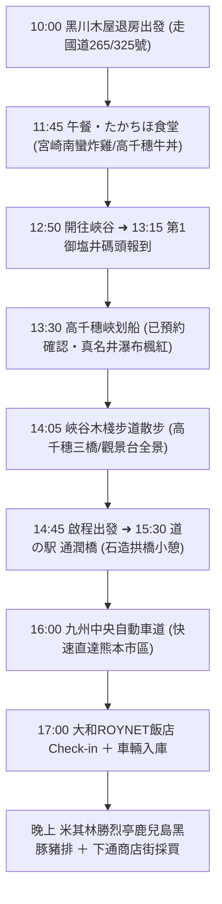

# 🍁 Day 3（11/17 二）：黑川木屋悠閒退房 ➜ 高千穗峽划船 ➜ 通潤橋 ➜ 熊本市區

> **今日主題**：穿越阿蘇南麓高原公路、平價道地たかちほ食堂、夢幻高千穗峽划船賞楓（13:30 已預約）、國寶通潤橋、入住熊本市中心五星精緻商務飯店、米其林勝烈亭豬排與下通血拼。  
> **今日總車程**：約 154 km｜**純行車時間**：約 2 小時 35 分  
> **導覽導航**：[⬅️ 回到 Day 2](file:///c:/Users/WW/Documents/repo/2026熊本/day2.md) ｜ [返回總行程目錄](file:///c:/Users/WW/Documents/repo/2026熊本/kyushu-autumn-travel-guide.md) ｜ [前往 Day 4 ➡️](file:///c:/Users/WW/Documents/repo/2026熊本/day4.md)

---

## 🕒 今日行程流程圖

---

## 📍 景點與自駕導航詳細資訊

### 【第一階段：早晨退房與高原景觀公路自駕】（10:00 - 11:45）

#### 1. 10:00 退房出發：行駛國道 265 號與國道 325 號
- **早晨節奏**：在木屋吃完早餐、收拾行李，10:00 辦理退房發車。
- **自駕行車路線**（黑川 ➜ 高千穗，約 73 km，開車約 1 小時 35 分～1 小時 45 分）：
  - 從黑川往南，途經阿蘇外輪山東側的「箱石峠」與高森町。
  - 全線為雙向柏油平整道路，秋天沿途經過雄偉的阿蘇外輪山、高原牧場與森林，山嵐繚繞極具自駕樂趣。

---

### 【第二階段：高千穗峽午餐與夢幻划船體驗】（11:45 - 14:45）

#### 2. 11:45 - 12:45 【午餐】たかちほ食堂（高千穗超人氣在地食堂）
- **自駕資訊**：
  - 地址：宮崎県西臼杵郡高千穂町三田井1099-1
  - 電話：`0982-72-2173`
  - 營業時間：11:00–14:00
  - [開啟 たかちほ食堂 Google Maps 定位](https://maps.app.goo.gl/nN6L6eS5h5YV3y2k8)
  - **停車位**：店門口附設約 6 台免費車位；若停滿可停對面高千穗町綜合運動公園停車場。
- **高 CP 值美食推薦（每人約 1,000～1,500 日圓，現金支付）**：
  - **招牌必點・宮崎南蠻炸雞定食（チキン南蛮定食，約 1,200 日圓）**：宮崎在地靈魂美食！大塊多汁的現炸雞肉，外皮金黃酥脆，裹上特調酸甜南蠻甘醋，再淋上滿滿濃郁塔塔醬，酸甜解膩極為下飯。
  - **高千穗牛丼 / 石鍋拌飯（約 1,000～1,100 日圓）**：以親民價格品嚐頂級高千穗牛，肉質甜嫩香濃。
  - **時間節奏**：出餐效率極高（點餐後約 10～15 分鐘上菜），12:45 即可輕鬆享用完畢，前往碼頭時間綽綽有餘。

---

#### 3. 12:50 - 13:15 開車前往高千穗峽谷底碼頭
- **交通**：從餐廳開車約 7 分鐘（3.5 km），沿專用下坡車道直達峽谷底。
- **最佳停車選擇**：
  - **導航目標**：**高千穂峡 第1御塩井（おしおい）駐車場**
  - **費用**：一次 1,000 日圓。
  - **優勢**：停在第 1 停車場走下樓梯 1 分鐘直接抵達划船碼頭！免去停在上方第 2、第 3 停車場需要爬 30 層樓陡峭樓梯的體力消耗。

---

#### 4. 13:15 - 14:05 【已確認預約】高千穗峽划船（13:30 梯次）
- **報到重要須知**：
  - **請於 13:15 前抵達乘船處售票櫃台報到**。
  - 出示預約完成確認信／預約番號，由工作人員引導穿著救生衣。
- **划船體驗重點（13:30 - 14:00，30 分鐘）**：
  - 夫妻同乘一艘木舟（由老公掌槳，划法很簡單，順著水流操控即可）。
  - 近距離划至日本百選名瀑「真名井瀑布」正下方，感受水氣撲面的壯闊震撼。
  - 抬頭仰望高達 80～100 公尺的阿蘇火山玄武岩柱狀節理絕壁，岩壁上點綴著火紅與金黃楓葉，宛如身處神話仙境。
  - 拍照建議：在瀑布兩側以山壁楓紅為背景互相拍照，效果絕佳！

---

#### 5. 14:05 - 14:45 峽谷木棧步道漫步
- **步道攻略（平緩無難度）**：
  - 划完船後，沿著峽谷步道漫步至「真名井瀑布展望台」，從高處往下俯瞰瀑布墜入碧綠峽谷與划船木舟的經典九州明信片全景。
  - 沿途可欣賞「鬼八之力石（重達 200 噸的巨大神話巨石）」以及「高千穗三橋（橫跨峽谷的三座不同時代拱橋）」。

---

### 【第三階段：經國寶通潤橋直達熊本市區】（14:45 - 晚上）

#### 6. 15:30 - 16:00 道の駅 通潤橋（Tsujunkyo）
- **自駕交通**：14:45 高千穗出發，行駛國道 218 號約 40 km，開車約 45 分鐘。
  - [Google Maps 定位](https://maps.app.goo.gl/uX3L3c5XgV4a5P8z6)
- **看點**：
  - 參觀列為日本國寶的石造水路拱橋「通潤橋」，建築雄偉壯觀。
  - 休息站建築極為新穎舒適，設有咖啡廳與在地農特產展售區，可在此喝杯咖啡小憩、換手或上洗手間。

---

#### 7. 16:00 - 17:00 九州中央自動車道 ➜ 熊本市區
- **行車路線**：
  - 從「山都通潤橋 IC」上高速公路，經「嘉島 JCT」直通熊本市區（約 40 km，行車約 40～50 分鐘）。
  - 此路段可使用 KEP 高速周遊券，路況極佳。
  - 11 月中旬日落約在 17:15，抵達熊本市區時天色尚亮，行車視野良好。

---

#### 8. 17:00 Check-in：大和ROYNET飯店 熊本銀座通店 PREMIER
- **飯店資訊**：
  - 地址：熊本県熊本市中央区新市街1-1
  - 電話：`096-311-6055`
  - [開啟飯店 Google Maps 定位](https://maps.app.goo.gl/ymrPLoDX8nSj3oVu9)
- **停車場指引**：
  - 飯店一樓附設**機械式立體停車塔**（每晚約 1,800～2,000 日圓，先到先停）。
  - 你們租的 Toyota Aqua / Nissan Note e-POWER 車身小巧，完全符合車高車寬限制，停入極度容易。
  - 若遇滿車，飯店旁即有特約平面停車場「AP Park 櫻町」（每晚約 1,200 日圓，步行僅 2 分鐘）。
- **飯店亮點**：
  - PREMIER 高階館別，客房新穎寬敞、衛浴乾濕分離且附獨立浴缸。
  - **地理位置無敵**：下樓一走出去就是熱鬧的「下通商店街」與「新市街」，購物用餐完全不用再開車！

---

### 【第四階段：熊本市中心美食與購物】（17:30 - 晚上）

#### 9. 17:30 - 19:00 晚餐：勝烈亭 新市街總店（米其林推薦黑豚豬排）
- **步行**：從飯店門口步行僅 **3 分鐘（約 200 公尺）**。
  - 地址：熊本県熊本市中央区新市街8-1
  - 營業時間：11:30–21:30
  - [Google Maps 定位](https://maps.app.goo.gl/qD3F7K4jM8R6zT5V8)
- **必吃推薦**：
  - **鹿兒島產六白黑豚厚切炸豬排（ロースかつ定食）**：熊本無人不知的傳奇名店！外皮麵衣酥脆如雪花，黑豚肉質多汁柔嫩、油脂甘甜完全不油膩。
  - 高麗菜絲、特選白米飯與紅味噌湯均可無限免費續加。
- *(其他備選：若想吃壽司可步行至「水天 活魚迴轉壽司」，或想吃拉麵可至「黑亭拉麵 下通店」)*

#### 10. 19:00 - 21:30 下通與新市街商圈血拼
- **下通拱頂商店街**：全天候遮雨拱頂，各大藥妝店（松本清、Sundrug）、驚安殿堂唐吉訶德、Bic Camera 電器行一應俱全。
- 夫妻可輕鬆逛街採買保養品、生活小物、伴手禮，買完直接散步回飯店放戰利品，非常輕鬆愜意。

---

## 💡 今日自駕小叮嚀
1. **划船準時性**：高千穗划船已確認預約 13:30 梯次，請務必於 **13:15 前** 在碼頭櫃台出示預約番號報到。
2. **高速公路通行**：從山都通潤橋 IC 進入高速公路，使用車載 ETC 卡並開啟 KEP，享有定額過路費優惠。
3. **市區停車**：抵達飯店停妥車輛後，今明兩晚在熊本市區均以步行或市電為主，不需再把車開進開出。
