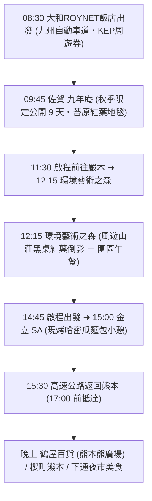

# 🍁 Day 4（11/18 三）：佐賀九年庵 ➜ 環境藝術之森 ➜ 金立SA ➜ 熊本市區購物

> **今日主題**：九州賞楓頂級盛宴！秋季限定 9 天絕美「九年庵」數寄屋日式庭園、萬株紅葉絕景「環境藝術之森」漆黑桌面倒影、金立 SA 必吃現烤哈密瓜麵包、傍晚返回熊本市區享受百貨血拼與地道美食。  
> **今日總車程**：約 265 km｜**純行車時間**：約 3 小時 30 分（全日高速公路，全程使用 KEP 周遊券定額吃到飽）  
> **導覽導航**：[⬅️ 回到 Day 3](file:///c:/Users/WW/Documents/repo/2026熊本/day3.md) ｜ [返回總行程目錄](file:///c:/Users/WW/Documents/repo/2026熊本/kyushu-autumn-travel-guide.md) ｜ [前往 Day 5 ➡️](file:///c:/Users/WW/Documents/repo/2026熊本/day5.md)

---

## 🕒 今日行程流程圖

---

## 📍 景點與自駕導航詳細資訊

### 【第一階段：秋季限定 9 天・佐賀九年庵】（08:30 - 11:30）

#### 1. 08:30 飯店出發：九州自動車道（使用 KEP）
- **自駕路線**：熊本 IC / 益城熊本空港 IC ➜ 九州自動車道往北 ➜ 鳥栖 JCT ➜ 長崎自動車道「東脊振 IC」（約 85 km，開車約 1 小時 15 分）。
- **高速公路周遊券（KEP）**：此段往返原過路費約 5,000 日圓，取車時購買的 KEP 可直接全額涵蓋，省時又省錢。

---

#### 2. 09:45 - 11:30 佐賀 九年庵（秋季限定特別公開）
- **自駕交通與停車**：
  - 導航搜尋：`九年庵` 或 `吉野ヶ里歴史公園 臨時駐車場`（公開期間有接駁專車或直達停車場）。
  - 地址：佐賀県神埼市神埼町的1688
  - 電話：`0952-37-0107`
  - [Google Maps 定位](https://maps.app.goo.gl/o1bZ1X4jQ8R5vV7C9)
- **景點特色與絕景**：
  - **秋季限定公開 9 天**：佐賀實業家伊丹彌太郎花費 9 年歲月建造的日式數寄屋別墅，**每年僅在 11 月中旬深秋紅葉見頃時開放約 9 天**！
  - **滿園紅葉與如茵青苔地毯**：庭園依築紫平原與脊振山脈為借景，鋪滿了厚實翠綠的青苔地毯，當金黃與豔紅的楓葉徐徐飄落於綠苔之上，紅白綠相映成趣，是全日本攝影愛好者公認的九州秋季極致庭園美學。
  - **行前叮嚀**：出發前一週請至神埼市觀光協會官網確認 2026 年確切公開日期與當日停車接駁指引。

---

### 【第二階段：紅葉萬株奇景・環境藝術之森】（11:30 - 14:45）

#### 3. 11:30 - 12:15 自駕前往嚴木町「環境藝術之森」
- **交通**：從九年庵出發，走國道 385 號與嚴木道路，約 35 km，開車約 45 分鐘。
  - 導航搜尋：`環境芸術の森`
  - 地址：佐賀県唐津市厳木町平之667
  - 電話：`0955-63-2008`
  - [Google Maps 定位](https://maps.app.goo.gl/3w8S5E3g7K6m7L9G8)
- **停車與門票**：附設大型免費停車場；美化協力金（門票）每人約 700 日圓。

---

#### 4. 12:15 - 14:45 環境藝術之森 ＋ 午餐
- **景點亮點**：
  - 園主花費 40 年歲月在作禮山山麓種植了超過 **10,000 株楓樹與銀杏**，打造出整座宛如仙境的紅葉森林。
  - **「風遊山莊」黑漆桌面倒影**：室內擺放著一整張極度光亮的漆黑木桌，將窗外漫山遍野的火紅、橙黃、金翠紅葉完美鏡面倒映於桌面上。坐在桌旁拍攝，隨手一拍就是雜誌封面等級的夢幻美照！
  - **森林散策**：提供 15 分鐘、30 分鐘與 60 分鐘不同長度的健行步道，沿途伴隨小橋流水、石燈籠與落葉步道，空氣格外清新。
- **午餐推薦**：
  - 園區內「風遊山莊」有提供在地清爽的山菜定食、日式和菓子與熱抹茶。
  - 或於周邊嚴木町的在地烏龍麵、蕎麥麵茶屋享用熱騰騰午餐。

---

### 【第三階段：金立哈密瓜麵包與市區血拼】（14:45 - 晚上）

#### 5. 15:00 - 15:30 長崎自動車道「金立 SA（上行/下行）」
- **自駕交通**：環境藝術之森出發，約 25 km，開車約 30 分鐘。
  - [Google Maps 定位](https://maps.app.goo.gl/4X6w8E1jY2r3vL5T7)
- **休息站超人氣名物**：
  - **金立哈密瓜麵包（金立メロンパン）**：西日本高速公路熱銷排行榜冠軍！外皮酥脆香甜，內餡加入了佐賀在地產的哈密瓜果汁，咬開香氣濃郁、麵包體極為鬆軟。
  - **佐賀伴手禮**：可順便購買佐賀著名特產「小城羊羹」、嬉野茶等精緻小禮。

---

#### 6. 15:30 - 17:00 返回熊本市區
- **交通**：行駛長崎自動車道 ➜ 鳥栖 JCT ➜ 九州自動車道 ➜ 熊本市區（約 85 km，開車約 1 小時 30 分）。
- **下午回到市區優勢**：在 17:00 傍晚前停妥飯店停車場，免除下班塞車潮，晚上擁有整整 4～5 小時的充裕時光自在探索熊本市區。

---

#### 7. 17:00 - 21:30 熊本市區逛街與晚餐推薦
- **飯店出發全靠散步，不必開車**：
  1. **鶴屋百貨（Tsuruya）**：
     - 九州知名老字號百貨，本館 1 樓設有熊本最具代表性的「**Kumamon Square 熊本熊廣場**」（可參觀部長辦公室並採買最齊全的熊本熊官方限定紀念品）。
     - 地下 1 樓美食街匯集熊本全縣銘菓伴手禮（如「譽之陣太鼓」、「武者返」）。
  2. **櫻町熊本（SAKURA MACHI Kumamoto）**：
     - 超大型複合商場，頂樓空中花園有超巨大的迎賓熊本熊公仔，傍晚可眺望熊本市區街景。
  3. **晚餐推薦（多樣化選擇）**：
     - **黑亭拉麵 下通店**：品嚐熊本最具特色的焦香黑麻油（マー油）豚骨拉麵搭配雙生蛋黃。
     - **牛かつ もと村 熊本店**：外酥內嫩的石板現煎炸牛排。
     - **和牛燒肉 / 居酒屋**：若想品嚐熊本特有的生馬肉綜合拼盤、肥後高菜炒飯與在地阿蘇燒酎，下通巷弄內有非常多口碑極佳的在地居酒屋。

---

## 💡 今日自駕小叮嚀
1. **KEP 周遊券效益最大化**：今日往返佐賀里程較長，全程行駛高速公路，上下交流道請確認行駛「ETC 專用車道」。
2. **鞋子選擇**：環境藝術之森與九年庵步道包含石階與森林泥地，建議穿著舒適好走的休閒平底鞋或球鞋。
3. **退稅提醒**：在下通商店街各大藥妝店與百貨購物時，請隨身攜帶護照正本以利辦理免稅手續。
