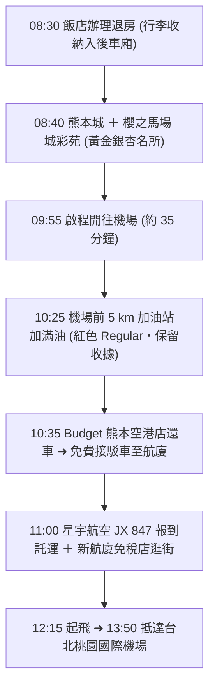

# 🍁 Day 5（11/19 四）：熊本城黃金銀杏 ➜ 還車加油 ➜ 星宇返台

> **今日主題**：日本三大名城「熊本城」壯麗巡禮、加藤清正親植 400 年黃金大銀杏、櫻之馬場城彩苑最後採買、機場前 5 km 加滿油還車、搭乘星宇航空 JX 847 平安滿載返台。  
> **今日總車程**：約 18 km｜**純行車時間**：約 40 分  
> **導覽導航**：[⬅️ 回到 Day 4](file:///c:/Users/WW/Documents/repo/2026熊本/day4.md) ｜ [返回總行程目錄](file:///c:/Users/WW/Documents/repo/2026熊本/kyushu-autumn-travel-guide.md)

---

## 🕒 今日行程流程圖

---

## 📍 景點與自駕導航詳細資訊

### 【第一階段：熊本城與城彩苑】（08:30 - 09:50）

#### 1. 08:30 飯店退房
- **行李安排**：辦理退房後，將所有大件行李、戰利品放進租車後車廂，直接出發。

---

#### 2. 08:40 - 09:50 熊本城 ＋ 櫻之馬場 城彩苑
- **自駕交通**：從飯店出發約 1.2 km，開車僅 5 分鐘。
  - **推薦停車場**：**櫻之馬場 城彩苑 專用停車場**（桜の馬場 城彩苑 駐車場）
  - 地址：熊本県熊本市中央区二の丸1-1-1
  - MapCode：`29 489 123*11`
  - 費用：每 2 小時 200 日圓，停好車即達城彩苑入口與接駁車候車處。
  - [Google Maps 定位](https://maps.app.goo.gl/37f8K4QW6e5c8A4E7)
- **看點一：熊本城天守閣與加藤神社**
  - 日本三大名城之一，天守閣已經震災後全面修復完畢，內部展示極具科技感與歷史底蘊。
  - **秋季看點・加藤清正手植 400 年黃金大銀杏**：
    - 熊本城又名「銀杏城」，相傳名將加藤清正築城時親手種植這棵大銀杏。
    - 每年 11 月中下旬，整棵巨大銀杏樹轉為璀璨耀眼的純金黃色，與黑白對比強烈的天守閣相映襯，是秋天造訪熊本城最具代表性的景觀！
- **看點二：櫻之馬場 城彩苑（櫻之小路）**
  - 重現江戶時代城下町風貌的傳統街道，聚集 20 多家在地老字號美食與伴手禮專賣店。
  - **必嚐點心**：現蒸「即席糰子（いきなり団子，地瓜紅豆泥軟糯點心）」、香脆竹輪明太子卷。
  - **最後補貨**：熊本銘菓「香梅」陣太鼓、武者返禮盒。

---

### 【第二階段：順暢加油與機場還車】（09:55 - 10:35）

#### 3. 09:55 - 10:25 開車前往阿蘇熊本機場
- **行車路線**：走縣道 36 號或國道 443 號，距離約 17 km，行車約 30～35 分鐘，沿途道路寬廣好開。

---

#### 4. 10:25 機場周邊加油站「滿油還車（滿タン返し）」
- **日本租車嚴格規定**：必須在還車前 **5 公里內** 的加油站加滿油，並**務必保留加油發票（レシート）**，還車時交給店員檢查。
- **加油要點**：
  - **油種**：**一般無鉛汽油（紅色油槍・Regular・レギュラー）**。
  - 跟加油員說：「Regular, Man-tan, O-ne-gai-shi-masu（レギュラー、満タン、お願いします）」加滿即可。
- **推薦 Budget 機場店旁加油站**：
  - **ENEOS 熊本空港給油所**（距離 Budget 僅 1.2 km，開車 2 分鐘）
    - 地址：熊本県菊池郡菊陽町戸次1388-1
    - [Google Maps 定位](https://maps.app.goo.gl/7e3Q5M1rK8P4aB6b8)
  - 或 **出光（Idemitsu）Apollostation 熊本空港前 SS**。

---

#### 5. 10:35 Budget 熊本空港店還車
- **還車步驟**：
  1. 將車輛開入 Budget 熊本空港店還車專用道。
  2. 工作人員檢查車輛外觀，出示剛才的**加油收據**。
  3. 拔下車載 ETC 卡，櫃台核對 KEP 周遊券涵蓋範圍並結清若有其他延伸之費用（若全程適用 KEP 則過路費為 0）。
  4. 領取所有後車廂行李，搭乘 Budget 專屬接駁車（車程 3 分鐘）直達熊本機場國際線出發大廳。
- **店鋪資訊**：
  - 地址：熊本県菊池郡菊陽町戸次1563
  - 電話：`096-232-8543`

---

### 【第三階段：熊本機場登機與甜蜜返台】（11:00 - 13:50）

#### 6. 11:00 - 12:15 阿蘇熊本機場（KMJ）登機與免稅購物
- **航班**：星宇航空 JX 847（阿蘇熊本 12:15 ➜ 台北桃園 13:50）。
- **報到手續**：
  - 11:00 抵達國際線航廈辦理登機與行李託運（開櫃時間通常為起飛前 2.5 小時至 45 分鐘截止）。
  - 通過安全檢查與出境審查。
- **阿蘇熊本機場全新航廈亮點**：
  - 熊本機場於近年全面改建完工，國際線候機區極為舒適新穎。
  - **免稅店採買最後清單**：
    - 各大日本名酒：獺祭二割三分、熊本在地純米大吟釀、阿蘇燒酎。
    - 超萌熊本熊官方限定玩偶、文具與食品禮盒。
    - 福砂屋長崎蛋糕、白色戀人、Royce 生巧克力、東京芭娜娜等全日本名產一應俱全。

---

#### 7. 12:15 起飛返台
- 登上星宇航空舒適班機，在飛機上享用精緻機上餐點，回味過去 5 天 4 夜九州美麗的紅葉風景與溫泉時光。
- **13:50** 平安順利降落台北桃園國際機場，圓滿結束 5 天 4 夜九州自駕蜜月賞楓之旅！🍁

---

## 💡 今日還車備忘錄
1. **加油發票**：加油完千萬不要隨手丟掉收據，Budget 店員驗車時一定會當場確認日期、時間與加油公升數。
2. **車內物品檢查**：還車前請仔細檢查車內置物箱、座椅底下、前檔手機架、門邊凹槽，特別確認護照、皮夾、手機充電線皆已隨身攜帶。
3. **退稅品密封**：若在市區購買之免稅品（藥妝、化妝品），在回國前請勿拆封外層透明密封袋。
