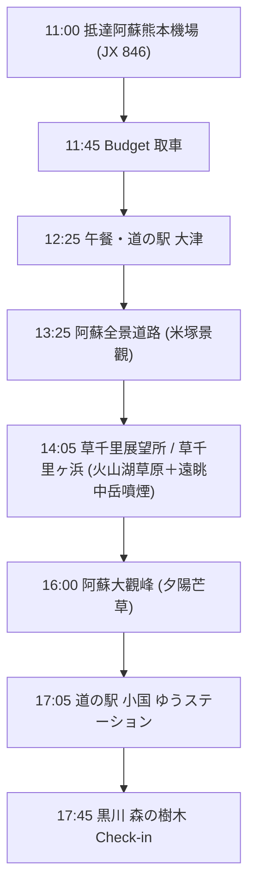
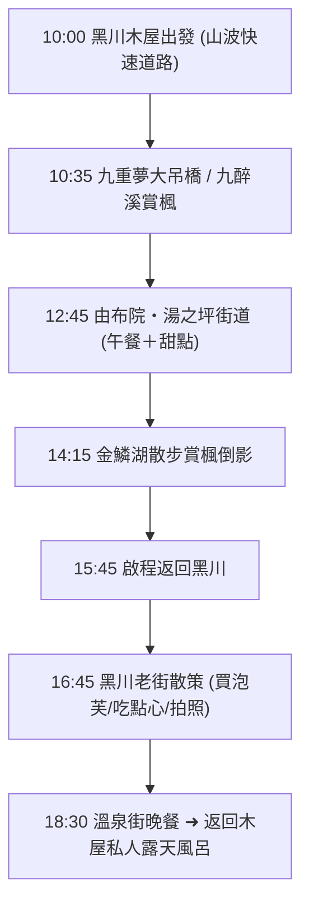
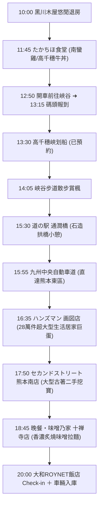
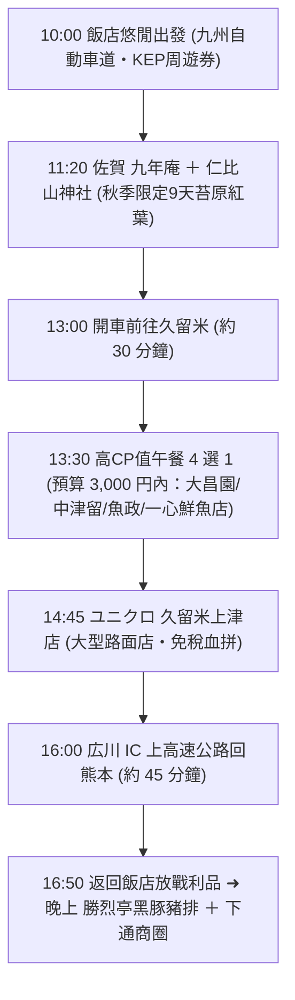
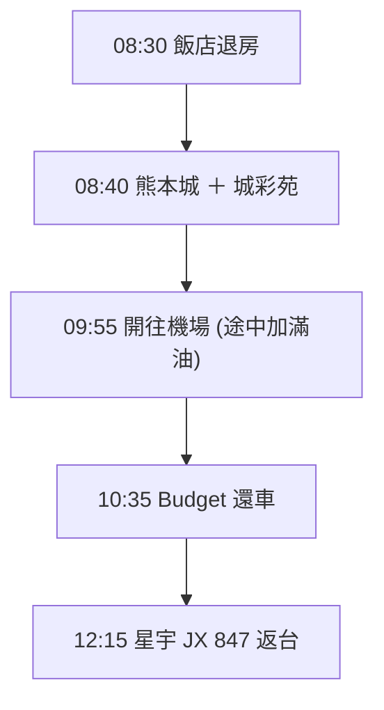

# 九州蜜月 5 天 4 夜・自駕賞楓詳細行程 🍁

> 2026/11/15（日）～ 11/19（四）｜熊本進出｜全程自駕
> 車程與里程依 Navitime / Google Maps 規劃；已排除柳川遊船與太宰府。

---

## 📌 基本資訊

| 項目 | 內容 |
| :--- | :--- |
| **去程** | 星宇 JX 846｜台北 TPE 07:45 ➜ 阿蘇熊本 KMJ 11:00 |
| **回程** | 星宇 JX 847｜阿蘇熊本 KMJ 12:15 ➜ 台北 TPE 13:50 |
| **租車** | Budget 熊本空港店｜EA 級 1.5L 油電車（Aqua / Note e-POWER，附 ETC 卡） |
| **保險** | Safety Pack 全險（CDW ＋ NOC ＋ 道路救援，0 自負額） |
| **Day 1–2 住宿** | [黒川 森の樹木](https://maps.app.goo.gl/PijNXt3EDmJ7Agfv6)（獨棟溫泉小木屋，私人露天風呂＋廚房） |
| **Day 3–4 住宿** | [大和ROYNET飯店 熊本銀座通店 PREMIER](https://maps.app.goo.gl/ymrPLoDX8nSj3oVu9)（下樓即下通商店街） |

### 每日車程與分日專頁

| 日期 | 主題 | 總里程 | 實際行車 | 單日專頁 |
| :--- | :--- | :--- | :--- | :--- |
| **Day 1**｜11/15（日） | 草千里展望所 ＋ 阿蘇大觀峰 | 約 78 km | 約 1 小時 55 分 | [📖 檢視 11/15(日) 阿蘇](file:///c:/Users/WW/Documents/repo/2026熊本/1115(日)_阿蘇.md) |
| **Day 2**｜11/16（一） | 九重夢大吊橋 ＋ 由布院 | 約 98 km | 約 2 小時 | [📖 檢視 11/16(一) 由布院](file:///c:/Users/WW/Documents/repo/2026熊本/1116(一)_由布院.md) |
| **Day 3**｜11/17（二） | 高千穗峽划船 ＋ 通潤橋 | 約 154 km | 約 2 小時 35 分 | [📖 檢視 11/17(二) 高千穗](file:///c:/Users/WW/Documents/repo/2026熊本/1117(二)_高千穗.md) |
| **Day 4**｜11/18（三） | 佐賀九年庵 ＋ 久留米美食 ＋ UNIQLO免稅 | 約 170 km | 約 2.5 小時 | [📖 檢視 11/18(三) 佐賀](file:///c:/Users/WW/Documents/repo/2026熊本/1118(三)_佐賀.md) |
| **Day 5**｜11/19（四） | 熊本城 ➜ 機場返台 | 約 18 km | 約 40 分 | [📖 檢視 11/19(四) 熊本](file:///c:/Users/WW/Documents/repo/2026熊本/1119(四)_熊本.md) |

---

## 📅 Day 1（11/15 日）：機場取車 ➜ 草千里展望所 ➜ 阿蘇大觀峰 ➜ 黑川木屋

---

### 【第一階段：落地取車與午餐】（11:00 - 13:25）

#### 11:00 - 12:15 入境與取車
- 降落後提領行李，到國內線航廈的 Budget 櫃台搭接駁車。
- **11:45 - 12:15** 在 Budget 熊本機場店取車：驗車、拍車身照、設定導航，並**加購 KEP 高速公路周遊券**。

#### 12:25 - 13:25 午餐：道の駅 大津
- **交通**：開車 10 分鐘，7 km。
- **推薦**：老公可以到「よかよ」吃招牌阿蘇赤牛丼或鐵板漢堡排定食；太太如果不餓，可以在戶外攤位買現烤蜜地瓜、地瓜鯛魚燒或赤牛可樂餅，兩人再坐在一起吃。

---

### 【第二階段：草千里火山草原與大觀峰夕陽】（13:25 - 16:45）

#### 13:25 - 15:15 阿蘇全景道路 ➜ 草千里展望所 ＋ 草千里ヶ浜
- **交通**：開車約 35～40 分鐘，25 km（經縣道 298/111 號阿蘇全景道路登山，途經米塚）。
- **停車**：草千里有料駐車場（小客車 500 日圓，車位約 500 台，MapCode: `256 456 795*03`）。
- **亮點**：
  - 漫步在古老火山口的「草千里雙水塘草原」，近距離欣賞倒映藍天的水塘與烏帽子岳。
  - 站在展望台木棧道，親眼目睹前方阿蘇中岳第一火山口陣陣噴發的壯麗白煙。
  - 在景觀咖啡館享用香濃阿蘇澤西鮮奶冰淇淋或熱咖啡。

#### 15:15 - 16:45 橫越阿蘇谷 ➜ 阿蘇大觀峰
- **交通**：下山穿越阿蘇市區平原直上北側外輪山脊（國道 212 號），約 28 km，開車約 40～45 分鐘。
- **大觀峰遊覽**：停車後走 3 分鐘平路到觀景台，俯瞰剛才造訪的阿蘇五岳（臥佛）與全破火山口，欣賞夕陽斜照下的金黃芒草波浪。

---

### 【第三階段：採買宵夜並入住木屋】（17:05 - 晚上）

#### 17:05 - 17:30 道の駅 小国 ゆうステーション
- **交通**：開車約 20 分鐘，16 km。
- **必吃**：「OGUNIYA JERSEY」純生乳霜淇淋。
- **採買**：小國鮮奶、布丁、阿蘇啤酒，帶回木屋當宵夜。

#### 17:45 Check-in：黒川 森の樹木
- **交通**：開車約 12 分鐘，8 km。
- **晚上**：泡獨棟木屋的私人碳酸水素鹽泉露天風呂，在森林裡看星空。

---

## 📅 Day 2（11/16 一）：山波公路 ➜ 九重夢大吊橋 ➜ 由布院 ➜ 黑川溫泉街

---

### 【第一階段：早晨睡到自然醒＋九重紅葉峽谷】（10:00 - 12:00）

#### 10:00 出發：山波快速道路（やまなみハイウェイ）
- 早上不用趕鬧鐘！悠閒吃早餐、在木屋專屬露天風呂泡個晨湯，10:00 準時發車。
- 行經名列日本百名道的景觀名道，秋天沿途滿山金黃芒草與九重連峰，視野極佳。

#### 10:35 - 12:00 九重「夢」大吊橋 ＋ 九醉溪
- **交通導航資訊**（開車約 35 分鐘，22 km，附設 229 台大型免費停車場）：
  - **Google Maps 定位**：[開啟 九重“夢”大吊橋（中村エリア）Google Maps](https://maps.app.goo.gl/3V7Qc7K6q3tGz8aA9)
  - **車載導航 MapCode**：`269 012 156`
  - **導航電話搜尋**：`0973-73-3800`
- **大吊橋**：走上日本最高人行吊橋（門票 500 日圓現場買），360 度俯瞰兩旁壯闊的紅葉峽谷與日本百選名瀑「震動之瀑」。
- **九醉溪**：開車穿過秋季最震撼的「九醉溪紅葉隧道」，沿途溪谷兩側山壁層林盡染。

---

### 【第二階段：由布院午餐、甜點與金鱗湖散策】（12:45 - 15:45）

#### 12:45 - 15:45 由布院／湯之坪街道／金鱗湖
- **交通**：開車約 40 分鐘，28 km（車停由布院車站周邊停車場）。
- **12:45 - 13:45 午餐**：品嚐由布院地雞飯（地雞鍋/定食）或豐後牛。
- **13:45 - 14:45 湯之坪街道散策**：一路散步吃排隊甜點（Milch 半熟乳酪蛋糕、金賞可樂餅）。
- **14:45 - 15:45 金鱗湖漫步**：走到湖畔欣賞秋季紅葉倒影、湖中鳥居，午後陽光灑在湖面波光粼粼，拍照極美。

---

### 【第三階段：黑川老街漫步與木屋專屬溫泉】（15:45 - 晚上）

#### 15:45 - 16:45 返回黑川
- **交通**：開車約 55 分鐘，48 km。

#### 16:45 - 18:30 黑川溫泉老街散策（純逛街拍照、免大眾池泡湯）
- **不用買湯手形、不進大眾池**：黑川老街依溪谷而建，木造傳統房舍非常有江戶懷舊氣氛，非常適合夫妻手牽手散步。
- **老街必逛美食**：
  - **白玉子茶屋（白玉っ子）**：享用現點現做、Q彈溫熱的抹茶白玉糰子。
  - **Patisserie Roku（麓）**：黑川人氣第一的「現烤脆皮焦糖泡芙」、布丁。
  - **「丸鈴勝」炸肉餅**：香氣四溢的在地赤牛炸肉餅。
  - **免費/銅板足湯**：如果想小試一下，溪畔有只泡腳的足湯（穿著衣服就能泡），完全免去坦誠相見的尷尬。

#### 18:30 - 19:45 晚餐推薦
- 可在老街「**わろく屋（Warokuya）**」品嚐阿蘇黑毛和牛咖哩飯或馬肉可樂餅；或至超市外帶九州火鍋食材回木屋。

#### 20:00 返回木屋：享受 100% 專屬的私人露天風呂
- **完全隱私**：你們訂的【黒川 森の樹木】是天然溫泉獨立小木屋，**每棟都有專屬的露天風呂（炭酸水素塩泉）**！
- 只有夫妻兩人獨享，可以邊泡湯邊看滿天星空，完全不必在意陌生人，安全感與隱私度 100%。

---

## 📅 Day 3（11/17 二）：黑川退房 ➜ 高千穗峽划船 ➜ 通潤橋 ➜ 居家二手挖寶 ➜ 味噌乃家拉麵 ➜ 飯店

---

### 【第一階段：早晨愜意退房＋景觀公路自駕】（10:00 - 11:45）

#### 10:00 退房出發
- 早上可以在木屋悠閒享用早餐、再泡一次露天風呂，不用匆忙收拾。
- 走國道 265 號與國道 325 號往南，穿越阿蘇山東南麓森林與高原公路直奔高千穗。
- **車程驗證**：約 73 km，開車約 1 小時 35 分～1 小時 45 分，路況平整順暢。

---

### 【第二階段：高千穗峽午餐與划船賞楓】（11:45 - 14:45）

#### 11:45 - 12:45 【午餐】たかちほ食堂（在地平價超人氣名店）
- **地點定位**：[開啟 たかちほ食堂 Google Maps](https://maps.app.goo.gl/nN6L6eS5h5YV3y2k8)（附設免費車位約 6 台，若滿可停隔壁綜合公園）。
- **預算每人 1,000 ～ 1,500 日圓（超省錢又道地）**：
  - **招牌必點・宮崎南蠻炸雞定食（チキン南蛮定食，約 1,200 日圓）**：外皮極酥脆、雞肉厚切多汁，淋上特製酸甜甘醋與自製塔塔醬，宮崎在地人公認第一名！
  - **高千穗牛丼 / 石鍋拌飯（約 1,000 ～ 1,100 日圓）**：免花大錢就能吃到香甜的高千穗黑毛和牛！
- **用餐時間優勢**：出餐快速（約 10～15 分鐘），約 12:45 就能輕鬆吃完，時間完全不緊繃（注意：只收日幣現金）。

#### 12:50 - 13:15 開車前往高千穗峽谷底碼頭
- **交通**：從餐廳開車約 7 分鐘（3.5 km），沿峽谷道路下行至**「高千穂峡 第1御塩井駐車場」**（付 1,000 日圓停車費，免去爬 30 層樓梯的辛苦）。
- **13:15 碼頭櫃台報到**：停好車步行 1 分鐘即達碼頭，出示預約信／番號領取救生衣。

#### 13:15 - 14:05 【已確認預約】高千穗峽划船體驗（13:30 梯次）
- **報到叮嚀**：**請務必於 13:15 前抵達「第1御塩井碼頭」售票櫃台**，出示預約番號並領取救生衣。
- **划船體驗（13:30 - 14:00）**：30 分鐘穿梭在火山柱狀節理玄武岩絕壁與「真名井瀑布」下方，仰望滿山火紅楓葉與飛瀑水氣，拍照極美！

#### 14:05 - 14:40 峽谷木棧步道漫步
- 走平緩的峽谷步道（約 1 公里），從「真名井瀑布觀景台」由上往下拍瀑布與小木舟全景，欣賞「鬼八の力石」與「高千穗三橋」。

---

### 【第三階段：經通潤橋開往熊本購物站】（14:45 - 16:35）

#### 15:30 - 15:55 道の駅 通潤橋
- **交通**：14:45 高千穗出發，開車約 45 分鐘，40 km。
- 欣賞日本最大級國寶石造拱橋「通潤橋」，於現代化休息站喝咖啡小歇。

#### 15:55 - 16:35 九州中央自動車道 ➜ 熊本市區東南
- **交通**：走九州中央自動車道（山都通潤橋IC ➜ 嘉島JCT），約 40 分鐘，33 km，直達熊本市東區重富一帶。

---

### 【第四階段：生活居家旗艦 ＋ 大型古著二手挖寶】（16:35 - 18:40）

#### 16:35 - 17:35 ハンズマン 画図店（HANDSMAN）
- **地點**：熊本県熊本市東区画図町大字重富1014-8（營業至 22:00，附超大型免費停車場）。
- **亮點**：九州最大級生活居家 DIY 巨蛋，28 萬件商品！日系廚具、文具生活雜貨、園藝手作，超好逛。

#### 17:50 - 18:40 セカンドストリート 熊本南店（2nd STREET）
- **地點**：熊本県熊本市南区江越1丁目20-33（從 Handsman 開車 4.5 km 約 12～15 分鐘，營業至 20:00，附專用免費車位）。
- **亮點**：日本知名大型二手店，嚴選男女潮流服飾、精品配件、日系雜貨，性價比極高。

---

### 【第五階段：炙燒味噌拉麵晚餐 ➜ 飯店入住】（18:45 - 晚上）

#### 18:45 - 19:45 晚餐：味噌乃家 十禅寺店
- **地點**：熊本県熊本市南区平田1-1-11（從 2nd STREET 開車僅 700 公尺，2 分鐘直達！附專用免費停車場）。
- **美食**：超人氣「特製炙燒味噌拉麵」，大火高溫爆炒蔬菜豆芽＋特厚炙燒叉燒＋香醇濃郁熟成味噌湯頭，深秋暖胃首選。

#### 20:00 Check-in：大和ROYNET飯店 熊本銀座通店 PREMIER
- **交通**：從餐廳開車 2.8 km 約 8～10 分鐘直抵飯店，車輛停入一樓機械停車塔。
- **晚上**：下樓即是下通商店街，散步採買藥妝伴手禮或吃消夜。

---

## 📅 Day 4（11/18 三）：佐賀九年庵 ➜ 久留米美食 ➜ UNIQLO免稅 ➜ 熊本勝烈亭豬排

---

### 【第一階段：早晨悠閒出發 ➜ 佐賀九年庵】（10:00 - 13:00）

#### 10:00 飯店出發
- 睡到自然醒，可於飯店 2 樓享用「菅乃屋」早餐，10:00 出發。
- 走九州自動車道 ➜ 長崎自動車道「東脊振 IC」（約 85 km，開車約 1 小時 15 分，全程 KEP 定額免過路費）。

#### 11:20 - 13:00 佐賀 九年庵 ＋ 仁比山神社
- **九年庵**：每年秋季僅公開 9 天的名勝庭園，滿地金紅楓葉飄落於厚實翠綠的青苔地毯上，極致優雅。
- **仁比山神社**：就在九年庵隔壁，參拜千年神木巨大楠木與紅葉仁王門，順道在參道屋台吃現烤糰子點心。

---

### 【第二階段：久留米高 CP 值午餐 4 選 1】（13:30 - 14:40）
- 從九年庵開車約 30 分鐘抵達久留米市區，每人預算 3,000 日圓內：
  - **燒肉選擇**：【大昌園 上津店】（老牌奢華日式庭園、頂級黑毛和牛定食約 1,800～2,500 円，離 UNIQLO 僅 3 分鐘）或【中津留 本店2F】（老肉舖直營、和牛燒肉/牛排丼約 1,650～2,200 円）。
  - **壽司/海鮮選擇**：【魚政】（鮮魚行直營、名物特上海寶丼/生魚片御膳約 1,800～2,400 円，離 UNIQLO 僅 8 分鐘）或【一心鮮魚店】（在地神級 1,430 円壽司定食附炸大草蝦）。

---

### 【第三階段：UNIQLO 免稅血拼 ➜ 返回熊本】（14:45 - 晚上）

#### 14:45 - 15:55 ユニクロ 久留米上津店（UNIQLO）
- **特色**：大型獨立路面門市，附設超大型免費停車場，**支援免稅（TAX FREE）**，秋冬保暖發熱衣、羽絨外套款式尺碼極度齊全。

#### 16:00 - 16:50 經「広川 IC」快速返回熊本市區
- 從 UNIQLO 開車 7 分鐘（3.5 km）即上広川 IC，高速公路直達熊本（約 65 km，45 分鐘），下午在飯店休息、避開塞車。

#### 17:30 晚餐：勝烈亭 新市街總店 ＋ 下通商圈血拼
- **晚餐**：下樓步行 3 分鐘品嚐米其林推薦「勝烈亭」鹿兒島產六白黑豚炸豬排。
- **晚上**：逛下通商店街、新市街（松本清、驚安殿堂唐吉訶德、Bic Camera）。

---

## 📅 Day 5（11/19 四）：熊本城銀杏 ➜ 還車 ➜ 搭機返台

---

### 【第一階段：熊本城】（08:30 - 09:50）

#### 08:40 - 09:50 熊本城 ＋ 城彩苑
- **交通**：從飯店開車 5 分鐘，1.2 km。
- **亮點**：日本三大名城的天守閣，加上很有名的巨大金黃銀杏樹（熊本城又叫「銀杏城」）。
- **採買**：在城彩苑買最後一批紀念品。

---

### 【第二階段：還車與登機】（09:55 - 12:15）

#### 09:55 - 10:30 開往 Budget 熊本機場店
- **交通**：開車約 35 分鐘，17 km。
- **加油**：在機場前 5 km 內的加油站加滿「一般無鉛（紅色 Regular）」，**保留收據**。

#### 10:35 還車
- 還完車搭接駁車到航廈，辦理 JX 847 登機手續。

#### 12:15 起飛
- 13:50 抵達桃園機場。

---

## ✅ 出發前備忘清單

> [!IMPORTANT]
> **高千穗划船已預約確認 ✅**：已成功搶下 **11/17（二）13:30 梯次**（一艇 5,100 日圓）。
> - **報到時間**：搭乘當天 **13:15 前** 至乘船碼頭櫃台報到。
> - **取消規定**：若行程有變，最晚可於乘船 2 天前（11/15 08:00 前）線上免費全額退款；如遇天候不佳官方停航亦全額退款。

| 項目 | 內容 |
| :--- | :--- |
| **取車文件** | 護照正本、台灣駕照正本、駕照日文譯本正本、信用卡 |
| **KEP 周遊券** | 取車時向 Budget 加購，Day 3、Day 4 的高速公路可以省下不少過路費 |
| **油種** | 一般無鉛汽油（紅色 Regular） |
| **還車加油** | 保留機場 5 km 內加油站的收據 |
| **九年庵** | 出發前確認 2026 秋季的公開日期 |
